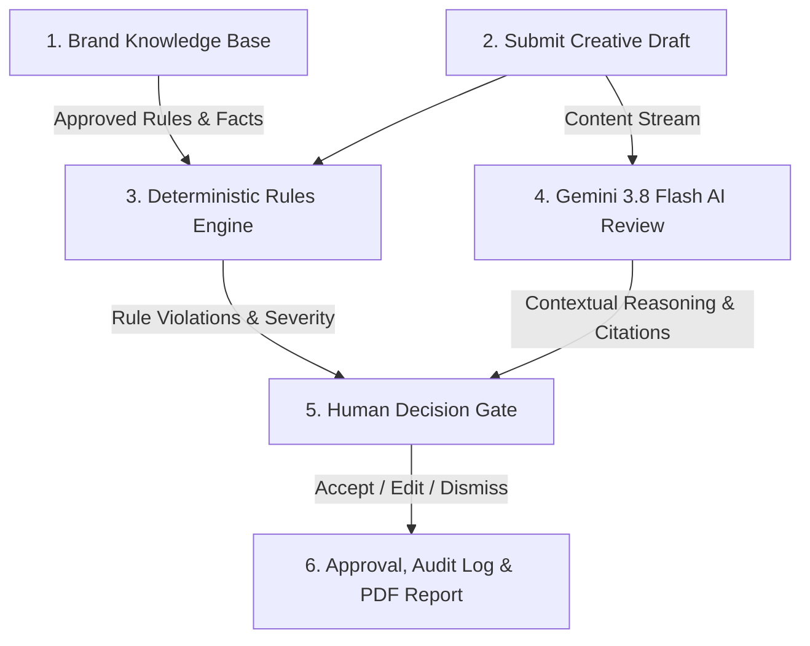

# BrandGuard — Intelligent Brand Governance Platform

[](https://github.com/akashrajput78616-maker/BrandGuard-AI-Integration)
[](https://react.dev/)
[](https://fastapi.tiangolo.com/)
[](https://ai.google.dev/)
[](https://frontend-psi-self-29.vercel.app)

> **Catch off-brand tone, wrong facts, unsupported claims, and accessibility violations before publication — with source citations, intent-preserving fixes, and mandatory human-in-the-loop oversight.**

---

## 📌 Project Overview

Marketing teams publish thousands of messages across campaigns, social media, and product launches. Without automated governance, unsupported superlatives, exaggerated promises, off-brand tone, and outdated facts slip through — creating significant brand damage and legal liability.

**BrandGuard** solves this by combining a fast client-side **deterministic policy engine** with **Google Gemini 3.8 Flash** AI review. It flags questionable phrasing, cites the exact approved brand guideline, provides confidence scores, suggests intent-preserving edits, and enforces an authorized human approval gate before publication.

---

## 🚀 Working Core Workflow (6 Stages)



1. **Build Knowledge Base:** Add approved brand rules, terminology guides, color swatches, and verified claims.
2. **Submit Content:** Paste copy, upload markdown/text drafts, or submit visual assets with alt-text.
3. **Deterministic Review:** Client-side rule matching detects known non-preferred terms and banned superlatives instantly.
4. **Gemini AI Analysis:** Google Gemini 3.8 Flash analyzes content contextually using strict JSON schemas.
5. **Human Decision Gate:** Reviewers accept intent-preserving suggestions, edit replacements, or dismiss with logged reasons.
6. **Approval & Audit Trail:** Authorized roles approve drafts, record timestamped decisions, and export compliance PDF reports.

---

## ✨ 12 Completed Features

| # | Feature | Category | Description |
| :--- | :--- | :--- | :--- |
| **01** | **Review Workspace** | Core Governance | Full editor with inline flagged phrases, severity tags (High/Medium), confidence scores, and comment threads. |
| **02** | **Brand Knowledge Base** | Truth Source | Searchable repository of brand rules, approved claims, terminology standards, color swatches, and TXT policy import. |
| **03** | **Insights Dashboard** | Analytics | Interactive Recharts visualizations of issue frequencies, draft pipeline stages, and policy clarity recommendations. |
| **04** | **Chronological Audit Log** | Accountability | Immutable record of every review action, human edit, approval decision, role attribution, and timestamp. |
| **05** | **AI Transparency Panel** | Responsible AI | Full disclosure of review engine mechanics, local privacy boundaries, and confirmation that no auto-publishing occurs. |
| **06** | **Role-Based Access Control** | Governance | Four distinct roles (**Creator**, **Reviewer**, **Manager**, **Admin**) with permission-gated approval actions. |
| **07** | **Gemini AI Review Engine** | Intelligence | FastAPI backend integrated with **Google Gemini 3.8 Flash** for deep contextual review with structured JSON schema. |
| **08** | **PDF Report Export** | Reporting | Client-side jsPDF generator producing comprehensive audit-ready compliance reports for reviewed content. |
| **09** | **Dark Mode & Responsive UI** | Usability | Accessible high-contrast dark/light theme switching with adaptive layouts across mobile and desktop. |
| **10** | **Marketing Landing Page** | Presentation | Conversion-ready homepage showcasing core value propositions, capability diffs (Before/After), and live interactive mockups. |
| **11** | **Dual Review Engine Architecture** | Reliability | Decoupled client-side deterministic rules engine and server-side Gemini AI review for 100% offline uptime and deep analysis. |
| **12** | **Privacy & Masking Controls** | Security | Sensitive content masking toggle, local demo isolation, and environment-protected API credentials in `.env`. |

---

## 🛠️ Technology Stack & Architecture

### Frontend (`/frontend`)
* **React 18** — High-performance component architecture
* **Vite 5** — Lightning-fast development & optimized production build
* **Framer Motion** — Fluid micro-animations and layout transitions
* **Recharts** — Responsive SVG charting for analytics
* **Lucide React** — Modern, clean iconography
* **jsPDF** — Dynamic client-side report and presentation generation

### Backend (`/backend`)
* **FastAPI** — Modern asynchronous Python API framework
* **Pydantic v2** — Strict request/response schema validation
* **Uvicorn** — Production-ready ASGI server
* **Google GenAI SDK** — Official client for Gemini 3.8 Flash
* **python-dotenv** — Secure environment variable management
* **CORS Middleware** — Secure origin binding

---

## 📦 Quick Start Guide

### Prerequisites
* **Node.js** (v18+)
* **Python** (3.10+)
* A **Google Gemini API Key** (from [Google AI Studio](https://aistudio.google.com/))

---

### Step 1: Run the AI Backend

```powershell
# Navigate to the backend directory
cd backend

# Create and activate virtual environment
python -m venv .venv
.\.venv\Scripts\activate

# Install dependencies
pip install -r requirements.txt

# Configure your API key
copy .env.example .env
# Edit .env and set:
# GEMINI_API_KEY=your_gemini_api_key
# GEMINI_MODEL=gemini-3.8-flash

# Start the FastAPI server
uvicorn main:app --reload --port 8000
```
Backend will be live at `http://127.0.0.1:8000`. Health check: `http://127.0.0.1:8000/api/health`.

---

### Step 2: Run the Frontend Application

```powershell
# Open a new terminal and navigate to the frontend directory
cd frontend

# Install dependencies
npm install

# Start the Vite development server
npm run dev
```
Open `http://localhost:5173/` in your browser.

---

## 🎯 Round 3 Roadmap (Three Major Improvements)

1. **RAG-Powered Knowledge Base & Document Ingestion:**
   * Transition from static rules to a Retrieval-Augmented Generation (RAG) vector pipeline.
   * Users upload PDF/DOCX policy guidelines; system chunks and embeds them using **Gemini Embeddings** into a vector database (pgvector/Pinecone) for contextual retrieval across hundreds of enterprise pages.
2. **Multi-User Collaboration & Enterprise Authentication:**
   * Implement OAuth 2.0 / JWT authentication with multi-tenant PostgreSQL.
   * Add real-time WebSocket communication for collaborative draft co-editing, threaded inline review comments, role-based approval queues, and Slack/Teams webhook notifications.
3. **Visual & Multi-Modal Brand Governance:**
   * Leverage **Gemini Vision** multi-modal capabilities to audit image assets, slide decks, and banner graphics.
   * Automatically detect unapproved logo variations, extract brand color palettes to verify hex code tolerances, and compute WCAG text-over-image contrast ratios.

---

## 📄 License & Attribution

Built with ❤️ by **Akash Rajput** for the **Inkloom AI Hackathon 2026**.
All code is open source under the [MIT License](LICENSE).
